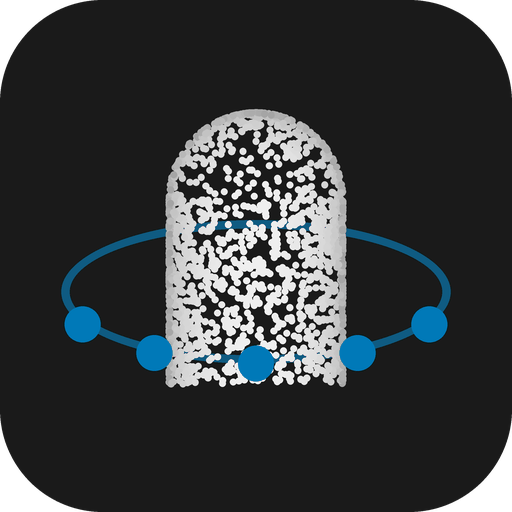
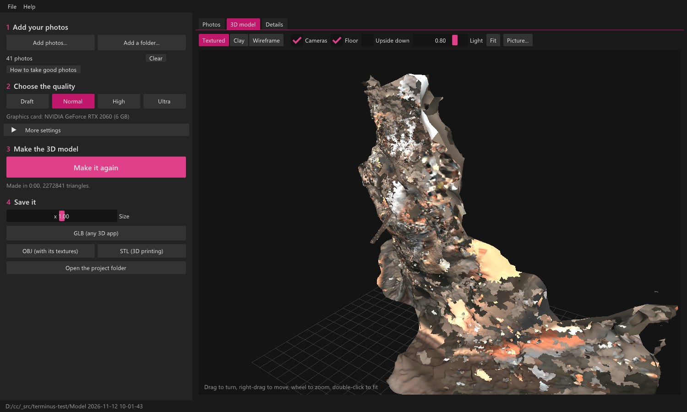

 

  

 

  
  
  
  

  
  
  

 

  

# Terminus

**Photos to a textured 3D model, on your own PC.** Walk round a thing taking photos, drop them on Terminus, press one
button: it works out where every photo was taken from, measures the depth in each one and builds a solid, textured
model you can turn, print or use in any 3D app. The photogrammetry is [AliceVision](https://github.com/alicevision/AliceVision)'s,
the engine of [Meshroom](https://github.com/alicevision/Meshroom), in a window anyone can use. Part of
**[Atelier](https://github.com/CursedPrograms/Atelier)**, Cursed Entertainment's creative suite.
**[Website](https://cursedprograms.github.io/Terminus/)**

## Features

- **Three steps:** add your photos (or a whole folder, or drop them on the window), pick a quality (Draft, Normal,
  High, Ultra), press **Make my 3D model**. Tips for taking good photos are one click away.
- **Every setting is a slider underneath:** how many points it looks for in each photo, how many photos each is
  compared with, a second kind of feature for plain and shiny surfaces, the size of the photos used for depth, the
  surface's detail, smoothing, keeping only the biggest piece, how many triangles to keep, the texture's size and
  sharpness, and filling gaps in the texture.
- **Watch it happen:** the steps tick off one by one with a progress bar and the time; as soon as the cameras are
  placed, the matched points and the cameras that took the photos appear in the 3D view.
- **The 3D view:** turn, move and zoom; textured, clay or wireframe; the cameras, a floor, how much light shapes it;
  save a picture of the view.
- **Save it:** GLB (one file with the texture inside: Blender, game engines, Windows' 3D Viewer, the web), OBJ with
  its textures, or STL for 3D printing, at the real size you set.
- **Carries on:** stop a build and carry on later from the step it got to; every model is a folder of its own, with
  a log of everything that happened.
- **Any PC:** an NVIDIA graphics card measures depth for full detail; without one, Terminus builds the model from the
  matched points by itself.

## Minimum requirements

| | |
| --- | --- |
| **System** | Windows 10 or 11, 64-bit |
| **Processor** | a 64-bit processor with 4 cores or more |
| **Memory** | 8 GB RAM (16 GB for High and Ultra) |
| **Graphics** | any graphics card with OpenGL 3.3 (2010 or newer); an NVIDIA card (CUDA) for full-detail depth, without one it still builds the model |
| **Disk** | 500 MB for the app, plus 1 to 5 GB for each model it builds |

## Download and run

Windows: **Terminus-setup.exe** from [Releases](https://github.com/CursedPrograms/Terminus/releases) installs it for
you (no administrator needed) with Start menu and Desktop shortcuts. Or unzip **Terminus-win64.zip** anywhere and run
`Terminus.exe`, or get it through the [Atelier launcher](https://github.com/CursedPrograms/Atelier). Everything it
needs is inside: AliceVision, the CUDA runtime and the Visual C++ runtime.

Models go into `Documents\Terminus` (or `Terminus` in your user folder when Windows guards Documents), one folder each.

**Good photos:** 30 to 200, walking all the way round, each sharing most of what's in the last one; again higher up and
lower down; sharp, in good light, without zooming between photos. Shiny, see-through and plain white things are hard.

## Build

Windows: Visual Studio 2022 (C++), CMake, Python and [Inno Setup 6](https://jrsoftware.org/isinfo.php), and the
`aliceVision` folder of [Meshroom 2025.1 for Windows](https://zenodo.org/records/16887472) (set `MESHROOM_AV` to it).
Then `build.bat` (or `build.ps1`): `tools/make_runtime.py` picks out the AliceVision programs Terminus runs and the
libraries they load (about 440 MB of Meshroom's 15 GB), and the build packs `dist/Terminus-win64.zip` and
`dist/Terminus-setup.exe`. `install.bat` / `install.ps1` install the build.

Linux: `./build.sh` (cmake, a C++17 compiler, libsdl2-dev), with AliceVision's `bin/` and `share/` in
`runtime/alicevision/`.

The code, in `src/`:
- `pipeline.cpp`: the photogrammetry steps (camera init, features, image and feature matching, structure from
  motion, depth maps, meshing, filtering, simplifying, texturing) with Meshroom's settings, carrying on where it stopped
- `proc.cpp`: runs AliceVision's programs without console windows, finds the graphics card, the models folder
- `model.cpp`: OBJ, PLY and the cameras in; GLB, OBJ and STL out
- `viewer.cpp`: the 3D view (OpenGL 3.3)
- `gui.cpp`: the window (SDL2, Dear ImGui)
- `splash.cpp`: the splash shown while Terminus starts, and in Help > About

## Credits

The photogrammetry: [AliceVision](https://github.com/alicevision/AliceVision) (MPL-2.0), with the pipeline and settings of
[Meshroom](https://github.com/alicevision/Meshroom) (MPL-2.0). The test photos in the screenshot are AliceVision's
[Monstree](https://github.com/alicevision/dataset_monstree) dataset. Built with [SDL2](https://www.libsdl.org),
[Dear ImGui](https://github.com/ocornut/imgui) and [stb](https://github.com/nothings/stb). See [NOTICE](NOTICE).

 

---
 

<a href="https://github.com/Farica-Kimora">Farica☆Kimora</a> © Cursed Entertainment 2026

 

